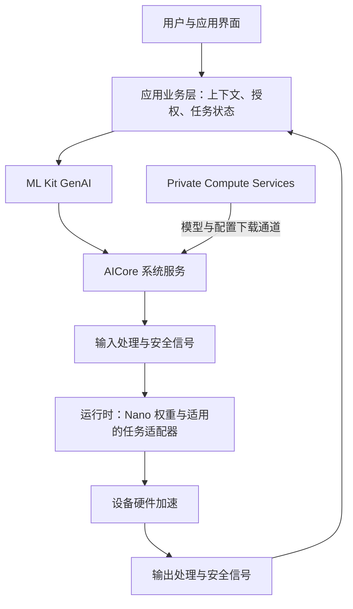

# Google 端侧大模型方案与实现流程

## 背景与核验范围

用户要求详细分析 Google 手机端大模型方案与实现流程。依据 2026-11-01 查阅的官方资料；未进行设备部署、代码编译或性能实测。API 版本、设备支持与预览资格随时间变化。

## 三条路线

| 路线 | 组成 | 开发者负责什么 |
| --- | --- | --- |
| 系统托管本地推理 | ML Kit GenAI → AICore → Gemini Nano → 设备硬件 | 场景、输入、能力检测、应用权限、结果与任务管理 |
| 自管本地模型 | App → LiteRT-LM/LiteRT → 自选兼容模型 → 硬件后端 | 另外负责模型分发、版本、设备兼容、内存、加载和性能 |
| 端云混合 | 本地模型 + Firebase AI Logic Hybrid API 或自定义路由 + 云模型 | 数据上云策略、云端接入、预算、故障与能力降级 |

Gemini 是模型家族与产品品牌，Gemini Nano 是端侧模型；AICore 是系统服务；ML Kit 是应用接入层；LiteRT-LM 是另一条开源部署路线。不能把 Gemini 手机应用的所有能力当作 Nano 本地推理，也不能把 AICore 等同于公开 LiteRT-LM 工程。

## 系统架构



这是基于公开文档的概念图，省略内部线程、进程及驱动细节，不声称所有模块对应独立进程。

Google 将模型管理从每个 App 中抽出，集中到 AICore；应用共享基础模型，平台处理模型分发、更新和硬件适配。共享权重不等于共享会话或用户数据，也不意味着推理不占设备内存。

AICore 不是应用可任意替换模型的通用模型服务器；公开 ML Kit 接口提供受支持的模型能力，不能据此认为能上传任意权重、任意 LoRA 或修改厂商内部运行时。普通 AOSP ROM 也不能通过添加 Maven 依赖就获得完整服务。

## 资产准备与首次启用

1. 选择官方支持的真机、对应 API 和模型能力，确认系统、AICore 配置和预览资格。
2. App 创建 ML Kit 客户端，动态查询当前能力状态。
3. 对未下载但支持的功能触发下载，并展示进度；下载中的功能进入等待状态。
4. AICore 管理模型资产；其本身不直接联网，模型下载等网络交互经 Private Compute Services 完成。
5. 状态可用后再接受推理任务；初始化/下载需要网络，不等于每次推理需要网络。
6. 需要时预热模型降低首次请求延迟；预热也有内存和资源成本。

任务专用 API 可使用共享基础模型上的 LoRA 适配器。它是小规模参数适配，不是每个功能各下载一套完整基础模型，也不是 App 必须自行训练。以官方摘要 API 为例，基础模型存在时仍可能需要下载功能适配器。

## 一次推理请求的流程

以应用内笔记摘要为例：

1. 用户主动选中文本；App 确保有访问权限，做长度与业务校验。
2. 查询能力是否可用，必要时选择等待下载、告知不支持或使用已获授权的其他路线。
3. 构造任务请求。任务 API 使用其配置；自定义生成传入提示、内容及受支持的生成参数。
4. SDK 调用 AICore，平台执行输入处理与相应安全检查。
5. 运行时加载/复用适用资产并执行推理，利用设备支持的硬件路径。
6. 从通用 Transformer 推理原理看，通常含输入分词、prefill、逐步 decode、KV Cache 使用和文本还原；这是原理解释，不能据此确认 AICore 某版本内部算子与缓存策略。
7. 输出经相应处理返回应用，应用展示结果、验证格式和业务约束。
8. 应用按需求保存结果、释放客户端及取消任务。不要将“不留存请求”的平台隐私保证当作 App 自动持久化机制。

输入输出内容过滤无法替代业务授权。例如模型建议删除笔记时，删除权限与用户确认必须在工具执行层判断。

## 应用接入层的三种选择

| 接口 | 适用需求 | 主要责任 |
| --- | --- | --- |
| 任务专用 API | 摘要、改写、校对、图片描述等预定义任务 | 选择输入类型/语言/输出形式，检查具体配置是否支持 |
| GenerativeModel / Direct model access（Beta） | 自定义提示、结构化输出、自己管理历史和工具调度 | 上下文构造、输出验证、工具结果回传与执行状态 |
| AgentRunner（Alpha） | 需要 SDK 管理多轮会话与工具调用循环 | 工具定义、访问控制、业务规则、风险确认、持久化与评测 |

AgentRunner 是应用中的编排层，不等于把所有业务逻辑移入 AICore。模型推理在本地，不代表工具也本地：工具若调用服务器，仍会发生网络访问。

## 最小接入流程

以下是阶段顺序与 API 关键点，不是完整可编译工程。

### 先验证自定义生成

当前官方 Direct model access 示例使用 `com.google.mlkit:genai-prompt:1.0.0-beta4`，通过 `Generation.getClient()` 获取客户端：

```kotlin
// 概念性流程；省略 import、UI 状态、错误处理及生命周期封装。
val model = Generation.getClient()
val status = model.checkStatus()
// UNAVAILABLE：告知不支持或执行应用定义的降级。
// DOWNLOADABLE：收集 model.download() 的进度，完成后重新确认状态。
// DOWNLOADING：显示等待状态，避免重复触发。
// AVAILABLE：允许提交请求。
val response = model.generateContent("用一句话说明这段示例文本的主题：……")
```

上例 `generateContent` 必须放在已确认 AVAILABLE 的分支中，并按所用 SDK 文档处理结果及资源；注释不能当作实际的状态判断代码。Task API 与 Direct API 的状态查询方法分别可能叫 `checkFeatureStatus()` 与 `checkStatus()`，不要混用示例。

### 再接入 AgentRunner

查阅时的官方 Alpha 入门条件包括 Android 14/API 34 以上设备并加入 AICore Developer Preview、受支持机型、项目 minSdk 26 以上、Kotlin 2.3 以上。minSdk 26 不表示 Android 8 真机就能运行该 Agent 预览能力。

当前示例依赖：`com.google.mlkit:genai-agent:1.0.0-alpha1`。创建 Agent 配置，建立 AgentRunner，获取 AgentSession，通过 `runAsync()` 收集事件，按生命周期关闭资源。该流程是受支持环境中的预览接入，不能当作对所有 Android 手机的量产承诺。

## 工具调用的实现流程

示例目标：“找出带有出差标签的笔记，整理为应用内待办草稿。”

1. 定义小范围工具：`searchNotes(tag)`、`createDraft(items)`、`getDraft(id)`；名称、参数和返回值明确。
2. 按当前官方方式用 Android AppFunctions 声明工具，KSP 生成所需元数据；遵循对应版本的服务注册要求。
3. 仅向 Agent 注册本场景需要的工具。内部工具采用合适的 SELF 访问范围；跨应用与系统调用有额外的权限边界。
4. 模型依据提示、历史与工具声明提出结构化调用。
5. 宿主侧校验参数、访问范围、业务状态；有副作用的动作加入幂等与必要的确认。
6. 工具执行返回结构化结果；模型据此继续调用或作答，直到完成、失败、取消或达到预算。
7. 对写入结果进行查询验证，用户收到反馈；记录去敏后的轨迹用于评测。

AgentRunner 可自动循环；Direct model access 则由应用管理工具调用和回传。普通 App 获得模型工具调用能力，不等于获得系统权限或任意控制其他 App。

## 隐私、上下文与进程恢复

- 官方说明 AICore 隔离请求，处理后不保留输入输出记录，且其网络交互受 Private Compute Services 约束。
- App 若主动上传文本、工具若联网、日志若记录正文，都需要各自的数据策略。平台模型的本地推理保证不能覆盖这些行为。
- Direct API 的多轮内容由客户端管理；AgentSession 提供内存历史。应用需要区分对话历史、任务状态、工具结果与用户长期偏好。
- 将 Runner/Session 放在 ViewModel 可应对配置变化；进程死亡后的业务恢复需要设计持久化、重建和副作用检查，不应假设内存会话可自动恢复。
- KV Cache 是推理缓存，不是长期记忆或可靠的任务数据库。

## 前台、配额与兼容性约束

当前 ML Kit GenAI 总览注明推理限于顶部前台应用；仅启动前台服务不能绕过限制。存在 BUSY、应用电量使用配额等错误，应退避或延迟，不能无限重试。

官方接入页还注明解锁 bootloader 设备不支持相关 API；设备刚初始化或 AICore 刚重置时配置可能尚未就绪。因此只看 Android 版本、芯片或 RAM 不足以判定可用，运行时状态检测是必要步骤。

任务 API 与 Direct API 的语言、上下文和模型版本能力各不相同。尤其不能从“支持摘要”推出“支持中文摘要”；应查目标 API 的语言列表并在目标设备评测。

## 端云路由

ML Kit 的本地生成调用不能被默认理解为“失败就自动上传”。Google 另外提供 Firebase AI Logic Hybrid API，也支持自定义路由。

Hybrid API 文档列出偏好本地、偏好云端、仅本地、仅云端四类模式。是否回退以及回退条件由所选模式与支持能力决定，不是所有错误都自动双向回退。

推荐业务顺序：先判断数据能否离开设备，再判断能力与资源，最后选择模型。对敏感输入，可要求仅本地，能力不足时明确失败/降级；不能先自动上传再告知。工具已执行但结果未知时，切换模型也不能盲目重放。

## 与 LiteRT-LM 的区别

LiteRT-LM 是公开的、基于 LiteRT 的 LLM 运行与编排框架，可用于应用自带模型部署。它让开发者获得更多模型选择和运行控制，也增加模型资产、硬件兼容和资源治理责任。

选择依据：

- 想研究 Google 系统共享模型能力：先走 ML Kit + AICore。
- 设备没有相应 AICore 支持，或需要自选模型：评估 LiteRT-LM 及其他运行时。
- 想研究系统服务与调度：可将自管运行时封装为 AIDL 服务作为学习工程，但这是模拟系统集成，不是复刻 AICore。
- 没有公开证据时，不把 AICore 的内部推理引擎、Binder 接口、芯片委托或模型精度写成固定结论。

## 面向 Android Framework 背景的建议实践

1. 设备核验：记录机型、系统、AICore、API/模型版本及能力状态。
2. 最小生成：文本输入、本地回复、初始化错误、取消和资源关闭。
3. 工具闭环：只用应用内示例数据，实现检索、草稿创建与读取验证。
4. 可靠性：Room 记录任务与工具调用状态，测试旋转、后台、断网、重复调用与进程死亡。
5. 指标：成功率、错误操作率、冷/热首响应、端到端 P95、内存、持续负载和配额错误。
6. 对照：再以 LiteRT-LM 实现同一场景，比较托管模型与自管模型的能力、资源和工程成本。

这些是建议，用户尚未确认项目或设备；本轮完成的是资料核验与归档。

## 官方参考

- [Gemini Nano 与 AICore 架构](https://developer.android.com/ai/gemini-nano)
- [ML Kit GenAI 总览：设备、配额、后台限制](https://developers.google.com/ml-kit/genai)
- [隐私与安全原理](https://android-developers.googleblog.com/2024/10/introduction-to-privacy-and-safety-gemini-nano.html)
- [Direct model access 入门](https://developers.google.com/ml-kit/genai/prompt/android/get-started)
- [摘要 API 与功能资产](https://developers.google.com/ml-kit/genai/summarization/android)
- [Agentic workflows 总览](https://developers.google.com/ml-kit/genai/agent/android)
- [Agent 入门和环境要求](https://developers.google.com/ml-kit/genai/agent/android/get-started)
- [工具声明与访问控制](https://developers.google.com/ml-kit/genai/agent/android/define-tools)
- [会话与生命周期](https://developers.google.com/ml-kit/genai/agent/android/manage-sessions)
- [流式事件与 UI](https://developers.google.com/ml-kit/genai/agent/android/streaming-events)
- [Hybrid inference](https://developer.android.com/ai/hybrid)
- [LiteRT-LM 官方仓库](https://github.com/google-ai-edge/LiteRT-LM)

关联：[[agent开发/端侧终端Agent转型/索引|专题索引]]、[[主流手机厂商的大模型部署方式]]、[[端侧终端Agent开发技能地图]]。
